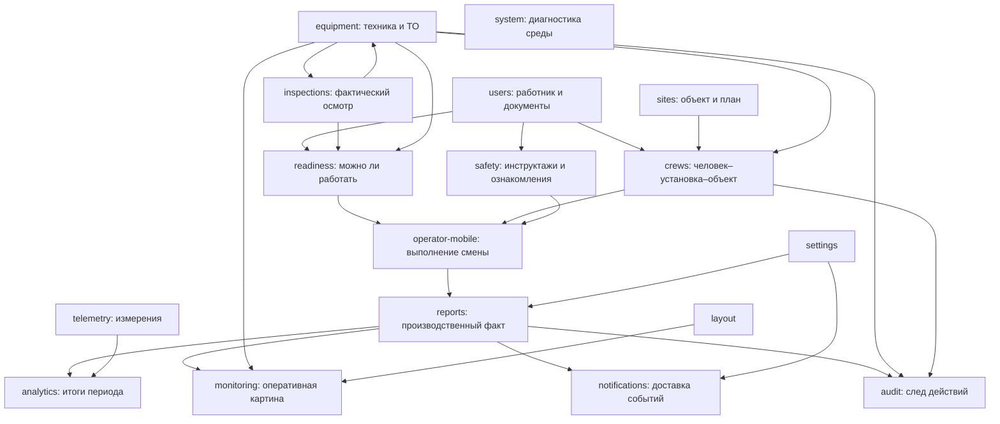

# PilingTrack: зрелость 17 модулей и их взаимосвязей

Дата: 22 октября 2026. Commit `0fc414d1a362e7093b11100539c8e2f0fded8314`.

## Главный вывод

PilingTrack уже имеет основу производственной системы: учёт факта работ, смены, состояние техники, осмотры, документы работников, готовность и доставка событий. Наиболее сильная архитектурная основа — **readiness**, главный носитель производственной ценности — **reports**, наиболее уязвимый координатор — **operator-mobile**.

Основная слабость приложения — согласование одного хозяйственного действия между несколькими модулями. Уменьшение выработки, завершение ТО и подтверждение ознакомления имеют разные представления и правила на разных входах. Это подтверждается R1–R4, а не выводится только из количества импортов. R5 отдельно показывает расхождение границ выборки и её заголовка.

**Мой выбор недооценённого модуля — crews.** Он определяет связь человек–установка–объект, от которой зависят доступная работа, принадлежность выработки и оперативная картина. **Для самого глубокого изучения выбираю readiness вместе с inspections/equipment.** Для развития управленческой пользы — analytics. Телеметрия имеет большой будущий потенциал, но её производственная состоятельность пока не доказана физическим оборудованием.

«Недооценённый» и «потенциал» здесь — экспертная оценка по коду и роли в процессах. Данных о частоте использования, потерянном времени сотрудников и коммерческой отдаче у этой проверки нет. Числовые рейтинги вроде 8,3/10 создавали бы ложную точность, поэтому используются качественные оценки и отдельные ограничения доказательств.

## Основание оценки

- Проверены текущий HEAD, статус рабочей копии и индекс GitNexus. Индекс относится к тому же commit; `query` и `context` выполнены для ключевых функций. Результаты графа подтверждались чтением исходников; отсутствие процессов/вызывающих не принималось за доказательство отсутствия связи.
- Выполнен AST-разбор литеральных import/export и dynamic import в `src`, без generated и тестовых файлов. [Машиночитаемая карта](D:/PillingR/wt-app-review-1022/output/app-review-1022/module-map.json), [скрипт](D:/PillingR/wt-app-review-1022/output/app-review-1022/module-map.cjs). Она включает типовые импорты и не претендует на полный runtime-граф. Общие таблицы, события, HTTP и выборки SQL создают дополнительные связи.
- Использованы проверки того же снимка из этой беседы: unit 5353 passed / 262 skipped; E2E 111 passed / 9 skipped / 0 failed из выбранных 120; integration 374 passed / 0 skipped / 1 failed. Сборка одноразового стенда прошла. [Подробности и ограничения](D:/PillingR/wt-app-review-1022/output/app-review-1022/E2E-REPORT.md).
- 195 исторических QA-E2E не исполнялись. Реальные датчики, производственная инфраструктура и все возможные гонки не проверены. В этом этапе новых тестов не запускалось: код и снимок не менялись; выполнялась архитектурная оценка.
- Это 17 каталогов `src/modules`, не вся архитектура приложения. Auth/tenancy, dictionaries, feedback, telegram, weather, часть телеметрии находятся в services; инфраструктура — в core/lib/workers. Маленький модуль-фасад не равен маленькой подсистеме.
- Текущий код уже содержит собственную реализацию users, analytics и system в modules. Старые архитектурные пометки о нахождении всей их реализации в services не описывают этот снимок точно. Telemetry остаётся фасадом services.

## Как переплетаются процессы

Схема показывает движение бизнес-фактов и решений, а не только вызовы функций. Один и тот же факт может читаться через общую БД или проекцию без прямого импорта между двумя модулями.

### 1. Назначение → работа → производственный результат

`users + crews + sites + equipment → operator-mobile → reports → analytics/monitoring`.

Бригада определяет, кто работает и на чём. Оператор фиксирует сваи, бурение, простои и передачу смены. Отчёт превращает это в учётный факт, а аналитика и мониторинг читают результаты. Ошибка назначения или принадлежности данных распространяется далеко за пределы формы бригады.

Здесь есть положительная основа: версии отчёта, атомарное сохранение вместе с событиями outbox, история версий, проверки конфликтов. Однако мобильные команды самостоятельно создают производственные строки в тех же таблицах. Формальная граница imports не делает правила записи едиными: R1 и R2 — прямое следствие рассогласования допустимых представлений/ограничений.

Источники: [репозиторий отчёта](D:/PillingR/wt-app-review-1022/src/modules/reports/infrastructure/report.repository.ts:109), [мобильная запись](D:/PillingR/wt-app-review-1022/src/modules/operator-mobile/application/commands/production.ts:280), [корректировки](D:/PillingR/wt-app-review-1022/src/modules/operator-mobile/application/commands/production-corrections.ts:114).

### 2. Техника → осмотр → готовность → начало смены

`equipment ↔ inspections ↔ readiness → operator-mobile`.

Это наиболее плотный архитектурный узел. В статических исходниках подтверждён цикл зависимостей `readiness → inspections → equipment → readiness`; имеются и обратные непосредственные связи readiness/inspections. Это риск распространения изменений, не доказательство ошибки загрузки модулей. Часть связей — необходимые доменные операции, поэтому просто удалять цикл или объединять папки нельзя.

Готовность читает осмотры, наряды, моточасы, дефекты, документы и правила, затем выдаёт решение. Equipment и inspections меняют исходные факты и запрашивают новый снимок. Граница, которую надо контролировать: завершилось ли всё хозяйственное действие и пересчитались ли все его последствия. R3 показал, что DONE наряда не всегда означает продвижение регламента.

Источники: [readiness вызывает правила inspections](D:/PillingR/wt-app-review-1022/src/modules/readiness/application/shifts/commands.ts:11), [авторитетный расчёт](D:/PillingR/wt-app-review-1022/src/modules/readiness/application/readiness-score.ts:19), [проектирование снимка](D:/PillingR/wt-app-review-1022/src/modules/readiness/application/projection/project-event.ts:26), [завершение связанного наряда](D:/PillingR/wt-app-review-1022/src/modules/inspections/application/commands/inspection-commands.ts:463).

### 3. Документы → ознакомление → допуск

`users → safety → operator-mobile/readiness` через запросы и общие данные.

Здесь нельзя свести всё к одному флажку «допущен». Действительный документ, проведённый инструктором инструктаж, подпись работника, проверка знаний и разрешение начать конкретную смену — разные факты. R4 показывает, что хотя бы в сводке ознакомления эти стадии сейчас смешиваются. При этом доказанного обхода серверного допуска в проверке нет.

Источники: [чистый расчёт документов работника](D:/PillingR/wt-app-review-1022/src/modules/users/operator-clearance.ts), [выборка ознакомлений](D:/PillingR/wt-app-review-1022/src/modules/safety/application/self-clearance-query.ts:94).

### 4. Запись → outbox → worker → проекция/уведомление

Эта связь пересекает границы каталогов modules: reports, readiness, core/outbox, notifications и workers. Принятый HTTP-запрос и завершившийся фоновый эффект — разные стадии. Отчёт может сохраниться раньше, чем обновится сводка или придёт уведомление.

Повторы и временные сбои предусмотрены: outbox, блокировки, повторные попытки, состояния доставки, пересборка проекций. Именно этот слой делает архитектуру сильнее обычного CRUD-приложения. Но его здоровье должно оцениваться по доставке и свежести результатов, а не только по доступности веб-сервера. Механизмы наблюдаемости уже частично есть в core/workers; следует связать их с пользовательскими процессами, не дублировать новой системой.

Источник: [доставка события](D:/PillingR/wt-app-review-1022/src/modules/notifications/application/durable-alert-delivery.ts:35).

## Оценка всех модулей

Оценка относится к наблюдаемой архитектуре и проверенным сценариям. «Сильный» не означает отсутствие ошибок, «ограниченный» не означает плохой код.

| Модуль | Оценка текущего состояния | Сильная сторона | Слабость / что раскрыть глубже |
|---|---|---|---|
| **readiness** | Сильная архитектурная основа, высокая сложность | Выделенные правила, объяснение решения, версии правил, фиксированные часы расчёта, команды с идемпотентностью, снимки, проекции, цепочка аудита | Слишком много связанных процессов: смены, дефекты, наряды-допуски, документы и оборудование. Нужны доказательства свежести решения и полного прохождения изменений через весь цикл. |
| **reports** | Зрелое производственное ядро, уязвимые границы | Агрегат, версии, атомарный outbox, история, восстановление проекций, экспорт | R1 и R5; правила отчёта переплетены с мобильными записями. Нужно согласовать исправления, сверку строк, заголовки и итоги всех представлений. |
| **operator-mobile** | Функционально богатый, наиболее хрупкий координатор | Реальный рабочий цикл машиниста/помощника, этапы, приёмка, чек-листы, производство, корректировки | R1/R2; отдельные пути записи и переходов, много зависимостей от readiness/reports/safety. Нужен глубокий разбор повторов, гонок, восстановления после обрыва связи и передачи смены. Замороженную область без отдельной команды не менять. |
| **equipment** | Хорошая база учёта жизненного цикла | Моточасы, топливо, документы, планы ТО, наряды и оперативное состояние в одном контексте | Связь осмотра с регламентом R3; согласовать источники моточасов и все способы завершения ТО. Не путать «есть отчёт» с «техника исправна». |
| **inspections** | Сильная предметная логика, неодинаковые побочные эффекты | Композиция чек-листов, типы блоков, фазы смены, повтор завершения, фиксация дефектов | R3 показывает разрыв между положительным осмотром и последствиями для обслуживания. Отдельно нужны отрицательные ответы, отмена, повтор, завершение с двух устройств. |
| **crews** | Сильный компактный модуль, недооценённая роль | Простой домен, транзакционное сохранение, защита устаревшего обновления, outbox; уникальность активной установки защищена БД | Членство бригады — критичный источник полномочий и принадлежности факта. Глубже проверить переназначение посреди смены, исторический состав, замену машиниста/помощника. Не добавлять сложное планирование без подтверждённой потребности. |
| **sites** | Добротная база производственного контекста | Иерархия объект–поле–куст–пикет, планы, доступ, состояния и управляемые операции удаления | Сильнее как реестр, чем как управление выполнением проекта. Потенциал: объяснение отклонений плана, готовность следующего участка, прогноз срока на основе достоверного факта. Прогноз — предложение, его точность не проверена. |
| **users** | Рабочая основа людей и документов | Документы, сроки, чистый расчёт препятствий и предупреждений, назначения | Не является всей системой авторизации: auth/tenancy находятся отдельно. Требует согласованного отношения к фактической роли, составу бригады, документам и срокам на границе смены. |
| **safety** | Полезный связующий модуль, семантически слабый участок | Сводит данные без второго независимого хранилища допуска, включает подписи и версии инструкций | R4; прежде всего развести проведённый инструктаж, полученную подпись, ознакомление и разрешение работы. Новые показатели до согласования смысла статусов лишь расширят путаницу. |
| **analytics** | Аккуратные агрегаты, ограниченное объяснение результата | SQL-агрегации вместо загрузки всех строк, разделение план/факт, периоды и tenants, расход по данным телеметрии | Сейчас преимущественно отвечает «сколько», слабее — «почему и что делать». Главный потенциал: причины потерь, сравнение сопоставимых работ, прогноз сроков, управленческие действия. Нельзя обещать себестоимость без данных затрат или причинность по одной корреляции. |
| **monitoring** | Хорошо ограниченная оперативная витрина | Отдельное чтение состояния парка и выработки, разделение reportStatus/equipmentStatus, явный asOf | Зависит от качества данных других модулей. Не превращать отсутствие свежего отчёта в доказательство простоя. Для каждого сигнала нужны источник, возраст и степень достоверности. |
| **notifications** | Небольшой, но проработанный компонент доставки | Сохранение прогресса, повтор, блокировки и дедупликация, настройки tenant | Не гарантирует exactly-once во внешнем Telegram при неопределённом сетевом исходе. Развитие — жизненный цикл реакции на событие: кто получил, кто принял в работу, устранена ли причина. Это предложение, не существующая функция. |
| **audit** | Полезный общий след действий с ограниченными гарантиями | Понятные тексты, актор, объект, requestId, история для пользователя | Общий recordAuditEvent пишет операционную ленту и допускает её сбой с предупреждением; это не та же гарантия, что у цепочки readiness. Нужно явно описать, какие действия имеют обязательный транзакционный след, а какие — best effort. Не объединять разные журналы механически. |
| **settings** | Сильный в своей узкой роли | Tenant-настройки, нормализация, advisory lock при обновлении | Малый размер скрывает большое влияние на время, документы, уведомления и отчёты. Глубже проверить изменение настроек во время открытой смены и понятность отказа/резервного поведения. |
| **layout** | Аккуратный ограниченный инструмент | Реестр разрешённых поверхностей, валидация, tenant/entity scope, значения по умолчанию | Настройка вида не должна скрывать обязательные предупреждения и создавать впечатление изменения фактов. Приоритет ниже согласованности производственных данных. Конкурентное редактирование шаблона отдельно не проверено. |
| **system** | Узкий диагностический фасад | Диагностика окружения и часть проверок среды | Его размер не отражает всю наблюдаемость приложения, которая живёт в core/workers. Требуется сквозное объяснение зависших процессов и возраста данных, а не только общий зелёный health. |
| **telemetry** | Заложенная платформа, минимальная доказанность эксплуатации | Приём пачек, ключи устройств, буфер, ограничение нагрузки, circuit breaker, накопленные значения и запросы анализа | Это facade над services, не 26 строк всей реализации. Реальные датчики не проверены. Sampling и drop — допустимы для части мониторинга, но без отдельного контракта недопустимы как гарантия полноты производственного/инженерного учёта. Нужны единицы, время, калибровка, пропуски, качество и происхождение измерения. |

## Сильные и слабые места в порядке значимости

**Самая сильная архитектура — readiness.** Функция `evaluateReadiness` выдаёт не просто число: решение, блокировки, предупреждения, доказательства, время и версию правил. Это основа объяснимого разрешения работы. Источники: [evaluator](D:/PillingR/wt-app-review-1022/src/modules/readiness/domain/evaluation/evaluator.ts:35), [цепочка аудита](D:/PillingR/wt-app-review-1022/src/modules/readiness/infrastructure/audit/append-audit.ts:20).

**Самый ценный производственный модуль — reports.** Он связывает действия на площадке с учитываемым результатом. Его следует укреплять вокруг инвариантов данных, а не оценивать только по удобству формы. Подтверждённые проблемы не отменяют сильной основы версий и outbox.

**Самый аккуратный небольшой домен — crews.** Защита от конкурентных назначений и устойчивость сохранения дают большую пользу при небольшом объёме логики. Источники: [репозиторий](D:/PillingR/wt-app-review-1022/src/modules/crews/infrastructure/crew.repository.ts:30), [ограничение БД](D:/PillingR/wt-app-review-1022/prisma/migrations/20260624000000_crew_equipment_active_unique/migration.sql:5).

**Самый хрупкий по взаимосвязям — operator-mobile.** Он координирует правила нескольких доменов, а не просто рисует экран. Локально правильное действие может не совпасть с административным путём того же действия. Его надёжность надо доказывать сценариями целой смены и повторов команд, а не числом компонентов.

**Самая слабая согласованность смысла статусов — safety.** R4 выявляет разницу между записью инструктажа и подтверждением работника. Это проблема договора о фактах, которую нельзя исправить одним цветом или надписью.

**Самая незавершённая эксплуатационная проверка — telemetry.** Это не оценка «плохой код»: программная заготовка есть, но точность, полнота и устойчивость реального измерительного тракта пока неизвестны.

## Что раскрывать глубже и каким результатом считать успех

| Приоритет | Контур | Что изучить / укрепить | Проверяемый результат |
|---|---|---|---|
| 1 | operator-mobile ↔ reports | Сохранение факта, уменьшение/увеличение, повтор отправки, конфликт версий, параллельное редактирование | Веб, мобильный экран, журнал, экспорт и аналитика дают одинаковый итог; сохраняется происхождение корректировок. Невозможен простой длиннее допустимого времени. |
| 1 | inspections ↔ equipment ↔ readiness | Все пути завершения ТО, запись моточасов, создание/снятие дефекта, пересчёт готовности | Одна хозяйственная операция даёт один и тот же регламент и вердикт независимо от экрана; повтор не создаёт второй эффект. |
| 1 | users ↔ safety ↔ readiness | Отдельные факты подписи, документа, знаний, ознакомления и решения о старте | В ожидающей подписи записи не возникает ложного ознакомления. Каждый статус имеет известный источник и основание. |
| 2 | readiness и фоновые проекции | Свежесть при смене суток/смены, опубликованных правил и времени; задержка/повтор/непорядок событий | Пользователь видит, на какой момент и по каким фактам принято решение; устаревший снимок не выдаётся за актуальный. Текущий неподтверждённый случай «осмотр сегодня» требует именно такой проверки. |
| 2 | crews и assignments | Замена людей/установки/объекта в середине смены | Прошлая выработка не меняет автора и контекст задним числом; новая работа относится к правильному назначению. Это цель проверки, наличие ошибки пока не установлено. |
| 2 | reports: журнал и выгрузки | R5 и границы 500/20000, отрицательные корректировки, фильтры | Заголовок и числовые итоги имеют явно одинаковую область; тест на 501 строку проходит без ослабления утверждения. |
| 3 | analytics + sites + equipment | Управленческие вопросы: где теряется время, какая причина ограничивает план, что можно исправить | Несколько понятных показателей ведут к конкретному действию; пользователь может открыть исходные факты. Прогнозы показывают ограничения данных. |
| 3 | telemetry | Один измерительный канал до масштабирования | Известны единицы и погрешность, часы синхронизированы, пропуски обнаруживаются, измерение можно связать с установкой/сменой. Полнота учётного канала не зависит от случайного sampling. |

Первые шаги — согласовать инварианты и исправить пять подтверждённых проблем, затем расширять аналитику. Не требуется массовая миграция services, переписывание всех модулей или микросервисы.

## Что показывают размеры и зависимости

AST-инвентаризация source-файлов (без тестов): readiness — 76 файлов, примерно 7,9 тыс. строк; operator-mobile — 39 / 7,6 тыс.; reports — 35 / 5,7 тыс. Количество строк включает комментарии и не является рейтингом качества.

Readiness имеет 128 статических import/export-ссылок из `src/app`; это **не 128 независимых маршрутов**. Высокая связанность объясняет, почему его изменение требует проверки нескольких процессов. Analytics при этом не имеет прямых импортов других modules, но читает их общие таблицы — формальная независимость здесь не равна независимости данных.

В telemetry каталог modules содержит один фасад, а буфер/приём/ключи устройств находятся в services. Объявлять такой модуль слабым по одному файлу было бы ошибкой. Аналогично инфраструктура уведомлений, аудита и диагностики распределена между modules/core/lib/workers.

## Практическое направление продукта

Развитие стоит вести от регистрации событий к помощи в принятии решений: почему установка не готова, какое действие снимет блокировку, почему объект отстаёт, кто отвечает за следующий шаг. Для этого уже есть большая часть фактов и механизмов.

Ключевой ресурс сейчас — доверие к фактам и их согласованность между экранами. Расширение количества экранов, виджетов или графиков имеет меньшую ценность, пока одна корректировка или одно завершённое ТО дают разные последствия в разных частях приложения.

Код в ходе этой оценки не изменялся. Исходный worktree сохранён, новая ветка/коммит не требовались: материалы добавлены в игнорируемый output существующей отдельной ветки ревью. Рекомендации не являются командой на реализацию, особенно в замороженных областях.
