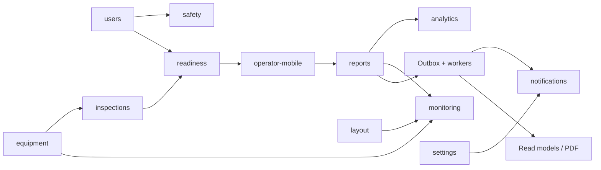

# Независимый структурный обзор PilingTrack

Дата: 23.10.2026. Worktree: `D:/PillingR/wt-module-fixes-1022`, ветка `codex/app-completion-1022`, HEAD на старте обзора `551e9f4c9797e2ed97a64016af12baf20dd4189c`. Часть рабочей копии меняется основным агентом; это обзор прочитанного среза, а не подписанный release manifest.

## Вывод и предел уверенности

Это предметно насыщенный модульный монолит с сильным транзакционным ядром. Ценность проекта — связка «допуск человека и установки → смена → выработка/паспорт → отчёт → доказательства и уведомления». Папка modules сама по себе не делает контексты независимыми: несколько модулей координируют одни таблицы и взаимно импортируются.

Осмотрены публичные entrypoints всех 17 модулей, ключевые domain/application/infrastructure реализации каждого, фасад telemetry и его фактическая реализация в services, DB/API/worker/outbox/leader/storage, четыре workflow. Это выборочное чтение ключевых путей каждого модуля, не построчный аудит всех файлов и маршрутов. `__tests__` не использованы для выставления баллов. В этой фазе **не запускались** npm, сборка, тесты, БД, browser или production. Числа предыдущего QA не выдаются за результаты структурного обзора. Основной агент сообщил build/lint exit 0; независимо здесь это не повторялось.

Пять исправлений R1–R5 не считаются открытыми дефектами. Замечания ниже — ограничения архитектуры/доказательств или кандидаты для отдельного воспроизведения; это не новый список подтверждённых багов. Production, credentials и `.env*` не читались. Разрешённый артефакт — только этот файл.

GitNexus ранее выполнен с явным `--repo D:/PillingR/wt-module-fixes-1022`; индекс сообщил `behind: 5`. Read-only обзор его не перестраивал. Для текущих связей использованы прямые импорты и исходники; нулевые процессы старого индекса не трактуются как отсутствие влияния.

## Стек и эксплуатационная форма

По прочитанному [package.json](D:/PillingR/wt-module-fixes-1022/package.json:1): Next.js `^16.4.1`, React `^19.2.5`, TypeScript `^6`, Tailwind 4, Radix UI, Zustand, Zod 4; Prisma 7.8 + adapter-pg, pg; BullMQ 6 + ioredis 6; AWS S3 SDK, PDFKit, Sharp, Sentry. Это диапазоны manifest, **не подтверждённые версии установленного runtime**; package и lock менялись основным агентом во время QA.

[db.ts](D:/PillingR/wt-module-fixes-1022/src/lib/db.ts:1) поддерживает PostgreSQL, ленивый Prisma client, transaction-local tenant context и default ReadCommitted. База не «универсальная SQLite/Postgres»: SQLite-ветка в system — остаточная совместимость. HTTP — Next route handlers и [api-wrapper.ts](D:/PillingR/wt-module-fixes-1022/src/core/api-wrapper.ts:62), домен в modules, инфраструктура в core/lib, сохранённые shared/legacy реализации в services. [next.config.ts](D:/PillingR/wt-module-fixes-1022/next.config.ts:5) задаёт standalone и строгие ошибки типов; production build явно webpack. Это не повод менять bundler без проверки CSP.

По [docker-compose.yml](D:/PillingR/wt-module-fixes-1022/docker-compose.yml:237) заданы PgBouncer, PostgreSQL 18, отдельные Redis state/cache и MinIO; app/workers разделены. [Dockerfile](D:/PillingR/wt-module-fixes-1022/Dockerfile:75) и [Dockerfile.workers](D:/PillingR/wt-module-fixes-1022/Dockerfile.workers:59) используют runner stages, непривилегированного пользователя и healthcheck. Внешний reverse proxy/фактические версии/ресурсы production здесь не проверялись.

[unified-worker.ts](D:/PillingR/wt-module-fixes-1022/src/workers/unified-worker.ts:1) запускает outbox/projection/PDF и планировщики в отдельном процессе; [leader-election.ts](D:/PillingR/wt-module-fixes-1022/src/core/infrastructure/leader-election.ts:29) использует owner-token Redis lease. Outbox — at least once, а не exactly once: [outbox-publisher.ts](D:/PillingR/wt-module-fixes-1022/src/modules/reports/application/outbox-publisher.ts:95) прямо требует идемпотентности обработчиков. PDF — BullMQ, файлы — [s3-service.ts](D:/PillingR/wt-module-fixes-1022/src/core/storage/s3-service.ts:54).

## Оценки 17 модулей

Шкала — субъективная инженерная оценка по пяти наблюдаемым критериям 0–2: **Д** — ясность доменных правил; **Т** — целостность, версии и повторы; **Г** — границы/связность; **Н** — наблюдаемость и поведение отказа; **П** — подтверждённость полного пути. Формат после балла: Д/Т/Г/Н/П. По П здесь максимум 1: код и предусмотренные проверки видны, live путь в этой фазе не выполнялся. 10/10 требует результата эксплуатации и приёмки, а не дополнительных слоёв. Уверенность всех баллов — средняя по устройству кода, низкая по production; разумная погрешность ±1 балл, у telemetry ±2. Сравнивать разницу в один балл как точное измерение нельзя.

| Модуль | Назначение | Сильная сторона | Ограничение и следующий шаг | Балл /10 | Проверенные исходники |
|---|---|---|---|---|---|
| analytics | План/факт объектов, парк, простой и выработка. | SQL агрегирует дочерние виды работ отдельно, исключая декартово умножение; период отделён от накопительного прогресса. | Крупные SQL-запросы: стоимость общих/all-time подзапросов зависит от объёма истории. EXPLAIN и бюджет времени не измерены. | 7 (2/1/2/1/1) | [site-analytics-service.ts](D:/PillingR/wt-module-fixes-1022/src/modules/analytics/application/queries/site-analytics-service.ts:58); [equipment-analytics-service.ts](D:/PillingR/wt-module-fixes-1022/src/modules/analytics/application/queries/equipment-analytics-service.ts:56) |
| audit | Читаемый след действий и история сущностей. | Единый каталог описаний, ограниченная история и счётчик потерь записи. | recordAuditEvent пишет в FeedbackEvent после действия и гасит сбой: это best effort, не транзакционный доказательный журнал. У reports/readiness иные механизмы. | 6 (1/1/1/2/1) | [audit-service.ts](D:/PillingR/wt-module-fixes-1022/src/modules/audit/audit-service.ts:66); [audit-history-service.ts](D:/PillingR/wt-module-fixes-1022/src/modules/audit/audit-history-service.ts:90) |
| crews | Состав бригады, закрепление машиниста, помощников, объекта и установки. | Агрегат, условная запись по loaded updatedAt, outbox и roster в одной транзакции; расформирование мягкое. | Проверка одной активной бригады на установку выполняется предварительным чтением. Нужна отдельная гарантия/демонстрация параллельного назначения; это кандидат, а не воспроизведённый дефект. | 7 (2/1/1/2/1) | [crew-command.service.ts](D:/PillingR/wt-module-fixes-1022/src/modules/crews/application/commands/crew-command.service.ts:39); [crew.repository.ts](D:/PillingR/wt-module-fixes-1022/src/modules/crews/infrastructure/crew.repository.ts:30) |
| equipment | Карточка и паспорт техники, документы, ТО, регламенты, моточасы, топливо. | ТО связано с регламентом; журнал показаний и готовность обновляются общими командами. Карточка имеет путь с блокировкой и expectedUpdatedAt. | Агрегат описывает лишь базовую карточку; инварианты обслуживания/метаданных находятся в отдельных командах. Два пути updateEquipment имеют разные гарантии версии. | 7 (2/1/1/2/1) | [equipment-command.service.ts](D:/PillingR/wt-module-fixes-1022/src/modules/equipment/application/commands/equipment-command.service.ts:21); [maintenance-regulation.ts](D:/PillingR/wt-module-fixes-1022/src/modules/equipment/application/commands/maintenance-regulation.ts:76); [equipment.repository.ts](D:/PillingR/wt-module-fixes-1022/src/modules/equipment/infrastructure/equipment.repository.ts:11) |
| inspections | ЕО/ТО, шаблоны обхода, ответы, фото, дефекты и завершение обслуживания. | Снимок композиции блоков, чистые правила полноты/оценки; завершение условное по версии, side effects в транзакции. | Команда завершения координирует много сущностей и соседних модулей; изменение требует матрицы сценариев фото/дефект/ТО/показание/повтор. | 8 (2/2/1/2/1) | [block-composition.ts](D:/PillingR/wt-module-fixes-1022/src/modules/inspections/domain/block-composition.ts:1); [inspection-logic.ts](D:/PillingR/wt-module-fixes-1022/src/modules/inspections/domain/inspection-logic.ts:49); [inspection-commands.ts](D:/PillingR/wt-module-fixes-1022/src/modules/inspections/application/commands/inspection-commands.ts:352) |
| layout | Сохраняемые раскладки карточек и страниц по организации. | Allow-list поверхностей, валидатор с пределами, цепочка override → base → default; клиентский вход отдельно. | Публичный PersistedTemplate сохраняет только version: тип поверхности затем восстанавливается приведениями (monitoring). Редактор требует проверки сохранения/изображений/адаптивности браузером. | 8 (2/1/2/2/1) | [layout-service.ts](D:/PillingR/wt-module-fixes-1022/src/modules/layout/application/layout-service.ts:31); [layout-template.ts](D:/PillingR/wt-module-fixes-1022/src/modules/layout/domain/layout-template.ts:126); [template-service.ts](D:/PillingR/wt-module-fixes-1022/src/modules/monitoring/application/template-service.ts:12) |
| monitoring | Сводный парк: выработка, наличие отчёта, рабочее/ремонтное состояние, карточки. | Явно отделяет presence отчёта от состояния техники; единый resolver operational state. | Расчёт фиксирует MSK; агрегирует в Node отчёты за 7 дней и все фото выбранного парка. Допущение о небольшом парке указано в коде, нагрузочная граница не доказана. | 7 (2/1/2/1/1) | [fleet-monitoring.service.ts](D:/PillingR/wt-module-fixes-1022/src/modules/monitoring/application/queries/fleet-monitoring.service.ts:29); [fleet-monitoring.service.ts](D:/PillingR/wt-module-fixes-1022/src/modules/monitoring/application/queries/fleet-monitoring.service.ts:106) |
| notifications | Надёжная доставка алертов из outbox в Telegram. | Блокировки события и dedupe key, отметки прогресса по чатам, настройка тенанта; ошибки возвращаются в retry/DLQ. | Сетевой send выполняется при открытой транзакции до 60 секунд. При неоднозначном ответе Telegram дубль остаётся возможен и честно описан. | 7 (2/1/1/2/1) | [durable-alert-delivery.ts](D:/PillingR/wt-module-fixes-1022/src/modules/notifications/application/durable-alert-delivery.ts:35); [telegram-delivery-progress.ts](D:/PillingR/wt-module-fixes-1022/src/core/notifications/telegram-delivery-progress.ts:1) |
| operator-mobile | Рабочая смена машиниста/помощника: допуск, осмотры, выработка, инцидент, закрытие. | Чистые фазы отделены от разрешения работать; смена блокируется перед командами, общий путь submitShiftReport, клиентский контракт отделён от БД. | Зависит от readiness/reports/safety/system и напрямую координирует общие таблицы. Полнота offline/replay и работа на настоящем телефоне этим обзором не доказаны; область frozen. | 8 (2/2/1/2/1) | [shift-phases.ts](D:/PillingR/wt-module-fixes-1022/src/modules/operator-mobile/domain/shift-phases.ts:1); [shared.ts](D:/PillingR/wt-module-fixes-1022/src/modules/operator-mobile/application/commands/shared.ts:65); [shift-close.ts](D:/PillingR/wt-module-fixes-1022/src/modules/operator-mobile/application/commands/shift-close.ts:124) |
| readiness | Техническая готовность, допуск к пуску, смены, дефекты и наряды. | Чистый evaluator с captured clock/evidence; version/ETag, hash+idempotency key, chained audit, snapshot/current projection, Serializable retry. | Большой координационный контур и цикл импортов с inspections/equipment. Снимок считает факты при обработке события, а clock — от события: семантику исторического воспроизведения нужно фиксировать отдельно. | 8 (2/2/1/2/1) | [evaluator.ts](D:/PillingR/wt-module-fixes-1022/src/modules/readiness/domain/evaluation/evaluator.ts:35); [execute-command.ts](D:/PillingR/wt-module-fixes-1022/src/modules/readiness/application/command-pipeline/execute-command.ts:56); [project-event.ts](D:/PillingR/wt-module-fixes-1022/src/modules/readiness/application/projection/project-event.ts:26) |
| reports | Сменная выработка, паспорт сваи, история, журнал и выгрузки. | Агрегат + единый repository, version claim, identity reconciliation, транзакционные audit/outbox/version; итог журнала до пагинации. | Мобильный и веб-контуры пишут одну предметную область разными командами. Гарантии их совместимости нужно держать явным контрактом; SQL/проекции/экспорт увеличивают число читателей. | 8 (2/2/1/2/1) | [report-command.service.ts](D:/PillingR/wt-module-fixes-1022/src/modules/reports/application/commands/report-command.service.ts:79); [report.repository.ts](D:/PillingR/wt-module-fixes-1022/src/modules/reports/infrastructure/report.repository.ts:112); [reconcile-report-entries.ts](D:/PillingR/wt-module-fixes-1022/src/modules/reports/infrastructure/reconcile-report-entries.ts:12); [pile-journal-totals.ts](D:/PillingR/wt-module-fixes-1022/src/modules/reports/application/queries/pile-journal-totals.ts:37) |
| safety | Охрана труда: ознакомление с редакциями, повторные инструктажи, подписи и матрица допусков. | Один чистый расчёт различает новую редакцию и просрочку повторения; сводка и личный вид используют подтверждённую историю. | Матрица допуска к виду техники пока сознательно справочная, не участвует в пуске. Каталог инструкций живёт в коде; утверждение содержания/редакций — внешняя ответственность. | 7 (2/1/2/1/1) | [briefing-requirements.ts](D:/PillingR/wt-module-fixes-1022/src/modules/safety/domain/briefing-requirements.ts:92); [self-clearance-query.ts](D:/PillingR/wt-module-fixes-1022/src/modules/safety/application/self-clearance-query.ts:63); [equipment-permits.ts](D:/PillingR/wt-module-fixes-1022/src/modules/safety/application/equipment-permits.ts:1) |
| settings | Настройки организации, часовой пояс и уведомления. | Advisory lock на read-modify-write; sanitizer, IANA timezone, перечень реализованных уведомлений. | При сбое чтения признака доставки возвращает true: выбран приоритет отправки, но изменение поведения нужно наблюдать. Сам факт сохранения units/currency не доказывает преобразование всех экранов. | 8 (2/2/2/1/1) | [settings-service.ts](D:/PillingR/wt-module-fixes-1022/src/modules/settings/application/settings-service.ts:58); [settings-service.ts](D:/PillingR/wt-module-fixes-1022/src/modules/settings/application/settings-service.ts:87); [settings.ts](D:/PillingR/wt-module-fixes-1022/src/modules/settings/domain/settings.ts:120) |
| sites | Объект, планы, иерархия полей/кустов/пикетов, назначения и жизненный цикл. | Версионный repository и outbox; планы сохраняются транзакционно; архивирование защищает незавершённые отчёты. | Параллельно существуют aggregate-команды и admin-команды с прямым Prisma. Общие правила и аудиторский контракт должны проверяться на обоих входах. | 7 (2/1/1/2/1) | [site-command.service.ts](D:/PillingR/wt-module-fixes-1022/src/modules/sites/application/commands/site-command.service.ts:35); [site-admin-command.service.ts](D:/PillingR/wt-module-fixes-1022/src/modules/sites/application/commands/site-admin-command.service.ts:79); [site.repository.ts](D:/PillingR/wt-module-fixes-1022/src/modules/sites/infrastructure/site.repository.ts:22) |
| system | Диагностика runtime и технических зависимостей. | Небольшой фасад, отделён от домена; диагностические ответы показывают конфигурацию и состояние rate limiter. | Локальный getReadinessStatus проверяет БД и наличие session config; не доказывает доставку, очереди и storage. Полный health-tracker живёт в core, поэтому этот модуль нельзя считать всей наблюдаемостью. | 6 (1/1/2/1/1) | [system-service.ts](D:/PillingR/wt-module-fixes-1022/src/modules/system/application/queries/system-service.ts:21); [system-service.ts](D:/PillingR/wt-module-fixes-1022/src/modules/system/application/queries/system-service.ts:57); [health-tracker/index.ts](D:/PillingR/wt-module-fixes-1022/src/core/observability/health-tracker/index.ts:1) |
| telemetry | Приём и чтение будущей телеметрии оборудования. | Тонкий сохранённый фасад; buffer batches по tenant, circuit breaker, счётчики dropped; ключи устройств отделены. | Приём возвращает buffered ID до фиксации; буфер RAM и sampling допускают потери. Лимит/настройка sampling локальны процессу. Не доказана точность, доставка и восстановление от реального прибора. | 5 (1/1/1/1/1) | [index.ts](D:/PillingR/wt-module-fixes-1022/src/modules/telemetry/index.ts:1); [telemetry-ingestion-service.ts](D:/PillingR/wt-module-fixes-1022/src/services/telemetry/telemetry-ingestion-service.ts:179); [telemetry-buffer.ts](D:/PillingR/wt-module-fixes-1022/src/services/telemetry/telemetry-buffer.ts:55) |
| users | Работники, назначения, документы, типы документов и личный допуск. | Безопасные DTO, ограниченные выборки, общий чистый evaluator допуска принимает tx reader для пуска смены. | Жизненный цикл работника, документы и вычисление допуска разделены файлами, но связаны с audit/security/media; изменения требуют согласованности UI и серверного допуска. | 7 (2/1/2/1/1) | [user-service.ts](D:/PillingR/wt-module-fixes-1022/src/modules/users/user-service.ts:23); [user-documents.ts](D:/PillingR/wt-module-fixes-1022/src/modules/users/user-documents.ts:62); [operator-clearance.ts](D:/PillingR/wt-module-fixes-1022/src/modules/users/operator-clearance.ts:103) |

## Связи и циклы

Ниже — смысловой поток, не развёртывание в отдельные сервисы:

Направление стрелок на рисунке — поток данных/использования в продукте; реальные импорты местами направлены иначе. По просмотренным статическим import/export имеется связная группа:

- `readiness/application/shifts/commands.ts:11` импортирует runtime `diffInspectionStates` из `@/modules/inspections`.
- `inspections/index.ts:4` реэкспортирует команды; `inspection-commands.ts:6–7` импортирует `equipment` и `readiness/server`.
- `equipment/index.ts:10` реэкспортирует обслуживание; `equipment-maintenance.ts:10–11` импортирует `readiness/server`.
- `readiness/server.ts:61` реэкспортирует команды смен, замыкая путь.

Следовательно, **цикл импортов подтверждён**, но ошибка инициализации/падение приложения из этого не следует. Поведение runtime цикла здесь не воспроизводилось. Узкий client/server entry уже есть и полезен; ближайший путь уменьшения связности — давать потребителям чистого правила узкий публичный client/domain контракт, не тянуть через barrel весь command graph. Это предложение для отдельной задачи с impact analysis, не разрешение на массовое переустройство.

Другая сильная зависимость — общий state: mobile/reports пишут Report и его строки, inspections/equipment/readiness — обслуживание и готовность. Поэтому публичные TypeScript entrypoints и layer-check не заменяют контракт владельца записи, версии, неизменности и журнала. Разделение агрегатов не означает раздельные транзакции там, где бизнес требует одного коммита.

Скан всех production `@/modules/...` ссылок (без тестов) также обнаружил `operator-mobile → safety/system/reports/readiness`, `safety/readiness → users`, `monitoring → equipment/layout`, `reports → readiness/settings/notifications/audit`; регулярный поиск не претендует на полную разрешённую сборщиком карту динамических импортов. `core/lib/services` дают дополнительные связи вне этой карты.

## CI и процессы: что хорошо и что ещё доказать

[ci.yml](D:/PillingR/wt-module-fixes-1022/.github/workflows/ci.yml:16) содержит lint, tsc, layer boundaries, migration guard, unit/contract coverage; отдельно workers Docker smoke и настоящие миграции/Postgres/RLS. Это сильнее проверки одного tsc.

[integration.yml](D:/PillingR/wt-module-fixes-1022/.github/workflows/integration.yml:132) собирает disposable HTTP stand, выполняет реальные интеграции и reject missing/skipped сценариев, затем Chromium golden path/roles/layout S3. [nightly-e2e.yml](D:/PillingR/wt-module-fixes-1022/.github/workflows/nightly-e2e.yml:166) добавляет сценарии на нескольких профилях с HTTPS и workers. Это **предусмотренные workflow**, а не подтверждённые в этом обзоре успешные GitHub runs.

[deploy.yml](D:/PillingR/wt-module-fixes-1022/.github/workflows/deploy.yml:36) ограничивает владельца/main, проверяет SHA, задаёт production environment, последовательное переключение поколения и health/version. Конкретный пробел gate: шаг Verify CI запрашивает **только ci.yml** ([deploy.yml](D:/PillingR/wt-module-fixes-1022/.github/workflows/deploy.yml:60)); независимый integration.yml из этого условия обязательным не становится. Branch protection и environment approval settings не читались, поэтому нельзя утверждать, что интеграция обходится в фактическом процессе. Для 10/10 нужен единый список обязательных результатов именно для развёртываемого SHA, включая выбранную браузерную/интеграционную приёмку.

[restore-drill.sh](D:/PillingR/wt-module-fixes-1022/scripts/restore-drill.sh:1) проверяет dump/manifest и восстанавливает только в новый помеченный контейнер, затем проверяет данные/роли. Наличие скрипта и synthetic CI drill ещё не доказывают доступность внешней копии, реальный off-site restore, production RPO/RTO. Их нужно измерять отдельно. Сетевой send Telegram и снимки на настоящем оборудовании также не доказываются PostgreSQL fixtures.

## Самые недооценённые части

1. **Layout** — небольшой код, но сильный ограниченный контракт: реестр допустимых поверхностей + валидаторы + fallback устраняют необходимость делать отдельный редактор на каждый экран. Оценивать его только числом файлов несправедливо.
2. **Settings** — транзакционный merge и корректный timezone влияют на смену, отчёты и уведомления сильнее, чем вид формы настроек. Важно сохранить точную семантику fallback, а не украшать форму.
3. **Inspections и notifications** — основная ценность в исполнении обязанностей: незавершённый обход, дефект, моточасы, ТО и доставка с подтверждениями по получателям. Это реальные доменные и отказные состояния, которые скрываются за простыми экранными названиями.
4. **Users/operator-clearance** — документы являются частью серверного решения о работе; это не второстепенный CRUD справочника.

Самые недооценённые **риски** — взаимное влияние писателей общих таблиц, неполная обязательность раздельных CI workflow и различие «записано/обработано/доставлено». Их не закрывают количество unit-тестов и аккуратное расположение папок.

## Практический путь к 10/10

1. **Согласовать доказуемый release contract:** один SHA, установленные зависимости/образы, обязательные CI/integration/browser checks без скрытых skips, артефакты и owner acceptance. Сначала закрыть неясность deploy gate, а не расширять стек.
2. **Зафиксировать владельцев общих операций:** Report original/correction/passport/version, факт ТО/регламент/показание, допуск человека/пуск смены. Для каждой границы — один воспроизводимый конкурентный и один replay/rollback сценарий в существующем контуре проверок; новые файлы/изменения требуют отдельной согласованной задачи.
3. **Проверить полный рабочий день на реальном телефоне:** все фазы, потеря сети/возврат, повтор отправки, фото, закрытие, веб-правка, журнал, экспорт и уведомление. Frozen экраны не менять без явной задачи владельца. Матрицу допуска к технике подключать к пуску только после отдельного решения и заполнения данных.
4. **Измерить эксплуатационные границы:** p95 SQL аналитики/мониторинга на ожидаемой истории и размере парка, очередь/старейшее событие, leader loss, stopped generation, длительность Telegram transaction, отказ Redis/S3. Для каждого бюджета есть владелец и проверенный сигнал.
5. **Проверить восстановление и физические интеграции:** внешняя копия и RPO/RTO; фактические получатели Telegram; для telemetry — durable acknowledgement policy, допустимая потеря, dedupe/порядок/clock, нагрузка нескольких процессов, настоящие датчики. До этого telemetry остаётся подготовленным каркасом.
6. **Только затем снимать конкретную связность:** узкие публичные чистые экспорты для подтверждённого цикла, типы поверхностей layout и документы владения записью. Массовая services→modules миграция, микросервисы, новые очереди и «переписать монолит» не требуются. Нынешние фасады — допустимая архитектура.

Критерий завершения каждого пункта — наблюдаемое воспроизведение с сохранённым результатом и ограничениями, а не новый README или рост тестового счётчика.

