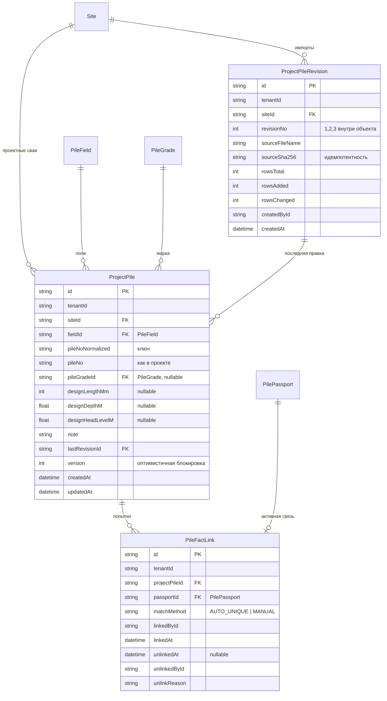

# ПТО — ERD для шагов 1–2

**Состояние:** предложение для решения владельца. Таблицы не созданы, миграции не писались.
Основа: `docs/pto/DISCOVERY.md` (снимок `2633a0b1`).

## 1. Шаг 1. Защита от потери паспортов

### Предложение

Две линии защиты, обе небольшие:

1. **Приложение.** `DELETE /api/reports/delete`: если у отчёта есть хотя бы один `PilePassport`, ответ 409 с понятным текстом («У отчёта есть паспорта свай. Удаление запрещено. Исправьте записи через журнал свай»). Проверка внутри той же транзакции, до `tx.report.delete`. Образец: `reconcile-report-entries.ts:52` и `hardDeleteSite`.
2. **База.** Внешний ключ `PilePassport.pileWorkId → PileWork.id` меняется с `CASCADE` на `RESTRICT`.

Остальные каскады не трогаем: `Report → PileWork` остаётся `CASCADE` (учётные строки без паспорта по-прежнему удаляются вместе с ошибочным отчётом), `PileDrivingSet → PilePassport` тоже (залог живёт, пока жив паспорт, а паспорт теперь удалить нельзя).

Как это работает вместе: отчёт без паспортов удаляется как раньше. Отчёт с паспортами остановит приложение (понятная ошибка), а если кто-то обойдёт приложение (ручной SQL, будущий код), остановит база: удаление дочерней строки `PileWork` упрётся в `RESTRICT` на `PilePassport` и вся операция откатится.

### Миграция (одна, логическая)

```sql
ALTER TABLE "PilePassport" DROP CONSTRAINT "PilePassport_pileWorkId_fkey";
ALTER TABLE "PilePassport"
  ADD CONSTRAINT "PilePassport_pileWorkId_fkey"
  FOREIGN KEY ("pileWorkId") REFERENCES "PileWork"("id")
  ON DELETE RESTRICT ON UPDATE CASCADE;
```

И в `prisma/schema.prisma:2317` (поле `pileWork` у `PilePassport`) `onDelete: Cascade` → `onDelete: Restrict`.

- Данные не меняются, миграция обратима (обратный `ALTER` возвращает `CASCADE`).
- Блокировка короткая, таблица небольшая.
- SQL пишется вручную, `migrate dev` не запускать (сбрасывает базу). Проверка: `migrate diff` без расхождений, `_prisma_migrations` после выкладки.
- Новые тесты: (а) маршрут отвечает 409 на отчёт с паспортом и по-прежнему удаляет отчёт без паспортов; (б) прямой `report.delete` на отчёте с паспортом падает на уровне базы (интеграционный).

### Побочные эффекты (проверить `impact` перед правкой)

- Удаление отчёта с паспортами станет невозможным. Если сегодня кто-то этим пользуется для «чистки» тестовых данных, ему понадобится другой путь (см. вопрос 1).
- Любой код, который удаляет `PileWork` напрямую, а не через отчёт, теперь упрётся в паспорт. По результатам разведки такого кода нет, кроме защищённого `report.repository.ts:169`.

## 2. Шаг 2. Проектный реестр

### Принципы

- Реестр **ссылается** на существующие паспорта и ничего из них не копирует. Таблица `PilePassport` не меняется.
- «Свая», «попытка забивки», «запись выработки», «паспорт» остаются разными счётчиками и вычисляются запросом, а не хранятся.
- Правки проектных данных идут с аудитом (`recordAuditEventInTx`), история изменений лежит в аудите, а не в отдельной таблице версий. Это на одну таблицу меньше, чем в ТЗ.

### Схема



### Таблицы и инварианты

**`ProjectPileRevision`** (одна запись на успешный импорт)
- `@@unique([tenantId, siteId, revisionNo])`.
- `@@unique([tenantId, siteId, sourceSha256])`: повторная отправка того же файла не создаёт вторую ревизию (AC02).
- Предпросмотр **не хранится**. Он считается на сервере из файла и возвращает таблицу ошибок и дублей. Коммит принимает тот же файл, пересчитывает проверки заново и записывает всё в одной транзакции или ничего (AC01). Так не нужны токены предпросмотра и очистка устаревших черновиков.

**`ProjectPile`** (одна проектная свая)
- `@@unique([tenantId, siteId, fieldId, pileNoNormalized])`: уникальна внутри поля, номера на разных полях законно совпадают (AC03).
- `pileNoNormalized`: обрезка пробелов, верхний регистр, единые тире, похожие кириллические и латинские буквы (С/C, А/A, В/B и т. д.). Одно правило нормализации живёт в `domain/` и покрыто тестами; им же сопоставляются номера паспортов.
- `fieldId` обязателен (в строке импорта поле должно быть названо; если на объекте одно поле, подставляется оно). Иначе нельзя гарантировать уникальность.
- `pileGradeId`, длина, глубина, отметка: необязательные; пустое значение = «проект не указал», а не ноль. Единицы в имени колонки.
- Новые значения при повторном импорте создают запись в аудите с `было → стало`, увеличивают `version` и ставят `lastRevisionId`.
- `onDelete` на `Site` и `PileField`: **`Restrict`**. Реестр содержит основу исполнительной документации, молчаливо удалять его вместе с объектом нельзя. Это потребует добавить количество проектных свай в проверку `hardDeleteSite` и `assertNoSubtreeProduction` (маленькая правка, чтобы отказ был понятным, а не FK-ошибкой).

**`PileFactLink`** (проектная свая ↔ паспорт, добавляется, не переписывается)
- Ссылка на `PilePassport`, а не на `PileWork`: запись с `count>1` без паспорта связи не получает, вымышленных паспортов не появляется (AC05).
- Активная связь: у паспорта не больше одной. Реализуется **частичным уникальным индексом** `UNIQUE (passportId) WHERE unlinkedAt IS NULL` (Prisma не описывает частичные индексы, задаётся в SQL миграции, образец есть на `Report`, `schema.prisma:1996`).
- Снятие связи: `unlinkedAt`, `unlinkedById`, `unlinkReason` обязательны, строка не удаляется.
- `onDelete` на `PilePassport` и `ProjectPile`: `Restrict`.

### Что считается запросом, а не хранится

| Показатель | Запрос |
|---|---|
| Выполнено проектных свай | число `ProjectPile`, у которых есть хотя бы одна активная связь |
| Попыток забивки | число активных `PileFactLink` |
| Паспортов без проектной сваи | `PilePassport` без активной связи, очередь ручного разбора |
| Проектных свай без факта | `ProjectPile` без активной связи |
| Дубли номера на объекте | группировка по `pileNoNormalized` внутри объекта |

Так расхождения между счётчиками невозможны (AC04, AC11).

### Правило автосопоставления

Кандидат: `ProjectPile` на том же объекте и поле, где `pileNoNormalized` совпадает с нормализованным `PilePassport.pileNumber`.

- Поле паспорта берётся из `PileWork.picketId → Cluster → PileField` (если пикет указан).
- Ровно один кандидат → **предложение** со статусом «ждёт подтверждения»; запись связи создаётся только действием инженера (или пакетным подтверждением списка, где все кандидаты уникальны). Молчаливых связей нет.
- Пикет не указан или кандидатов несколько → строка в очереди «выберите вручную» (AC03).

### Права и API

- Просмотр и работа с реестром: расширить `piles.manage` (`authorization.ts:71`, сейчас ADMIN, DISPATCHER, FOREMAN) либо завести одно `pto.registry` для ADMIN и инженера ПТО (роли «инженер ПТО» в коде нет, см. вопрос 2). Остальные десять прав из ТЗ не нужны, пока нет экранов, которым они нужны.
- Маршруты `src/app/api/pto/**` через `withApi` / `withMutation`, Zod `safeParse`, tenant fail-closed.
- Первые три маршрута: `POST /api/pto/registry/preview`, `POST /api/pto/registry/commit`, `GET /api/pto/registry/piles` (курсорная пагинация), позже `POST /api/pto/registry/links`.
- Код в `src/modules/pto/{domain,application,infrastructure,contracts}` по образцу `reports/`, импорт только из `@/modules/pto`.

### RLS (на каждую новую таблицу)

```sql
ALTER TABLE "<Таблица>" ENABLE ROW LEVEL SECURITY;
ALTER TABLE "<Таблица>" FORCE ROW LEVEL SECURITY;
CREATE POLICY "tenant_isolation_<таблица>" ON "<Таблица>" FOR ALL
  USING ("tenantId" = current_setting('app.current_tenant', true));
```

Строгое равенство, без «ИЛИ тенант не задан». Порядок раскатки и проверки: `docs/runbooks/012-rls-fail-closed.md`.

### План миграций по порядку (каждая отдельно)

| № | Что | Риск | Откат |
|---|---|---|---|
| 1 | `PilePassport.pileWorkId` `CASCADE → RESTRICT` | низкий, данные не меняются | обратный `ALTER` |
| 2 | Таблицы `ProjectPileRevision`, `ProjectPile` + RLS | низкий, таблицы новые и пустые | `DROP TABLE` |
| 3 | Таблица `PileFactLink` + частичный индекс + RLS | низкий | `DROP TABLE` |

Миграции 2 и 3 разделены, потому что реестр без связей уже полезен (сверка плана со схемой), а связи добавляют правила сопоставления.

## 3. Порядок работы после утверждения

1. Шаг 1: правка маршрута + миграция 1 + тесты. Самостоятельный PR, полезен независимо от ПТО.
2. Шаг 2а: домен (нормализация номеров, правила предпросмотра и сопоставления) с тестами, **без базы**.
3. Шаг 2б: миграции 2–3, репозиторий, маршруты, интеграционные тесты (tenant, повтор, конфликт версии).
4. Шаг 2в: экран реестра и очередь сопоставления (в `/admin/reports`, отдельной вкладкой, пока без нового пункта меню).

Выкладка каждого шага только по команде владельца.

## 4. Критерии приёмки (из ТЗ, только относящиеся к шагам 1–2)

AC01 (импорт 500 свай с ошибками в предпросмотре), AC02 (повторный импорт без дублей), AC03 (одинаковые номера на двух полях требуют ручного выбора), AC04 (две попытки = 2 операции и 1 выполненная свая), AC05 (`count=5` без паспортов не создаёт паспортов), AC06 (журнал и экспорт без изменений), AC16 (другой арендатор не видит). Дополнительно: удаление отчёта с паспортом отклоняется приложением и базой (шаг 1).

## 5. Что сознательно НЕ входит

Геодезия, испытания, материалы, документы, согласование, ЭП, пакет заказчику, нормативные шаблоны, карта поля, аналитика ПТО. Они зависят от решений, которых пока нет (кто внешние пользователи, какие образцы форм).

## 6. Решения и данные, нужные от владельца

Все вопросы закрытые, от них зависит шаг 1 и шаг 2.

1. **Что делать с удалением отчёта с паспортами:** (а) полностью запретить (рекомендую; ошибочный отчёт исправляется записями и поправками), (б) заменить «аннулированием» с причиной, отчёт остаётся скрытым. (б) заметно дороже.
2. **Роль инженера ПТО:** (а) пока работать под существующими ADMIN, DISPATCHER, FOREMAN через `piles.manage` (рекомендую), (б) завести отдельную роль сразу. Отдельная роль меняет CHECK в базе и список ролей в коде (два владельца списка, см. память), поэтому дороже.
3. **Поле в строке импорта:** обязательно (рекомендую). Да или нет?
4. **Пример реального проектного реестра** (XLSX или CSV с одного живого объекта, без персональных данных): чтобы колонки импорта строились по факту, а не по догадке. Приложить файл.
5. **Запрос для оценки данных** (запускает владелец на проде, только чтение). Покажет, сколько в реальности повторных забивок и совпадающих номеров:

```sql
SELECT
  count(*)                                              AS passports,
  count(DISTINCT "pileNumber")                          AS distinct_numbers,
  count(*) - count(DISTINCT "pileNumber")               AS repeated_numbers,
  count(*) FILTER (WHERE "redriven")                    AS redriven
FROM "PilePassport";
```
